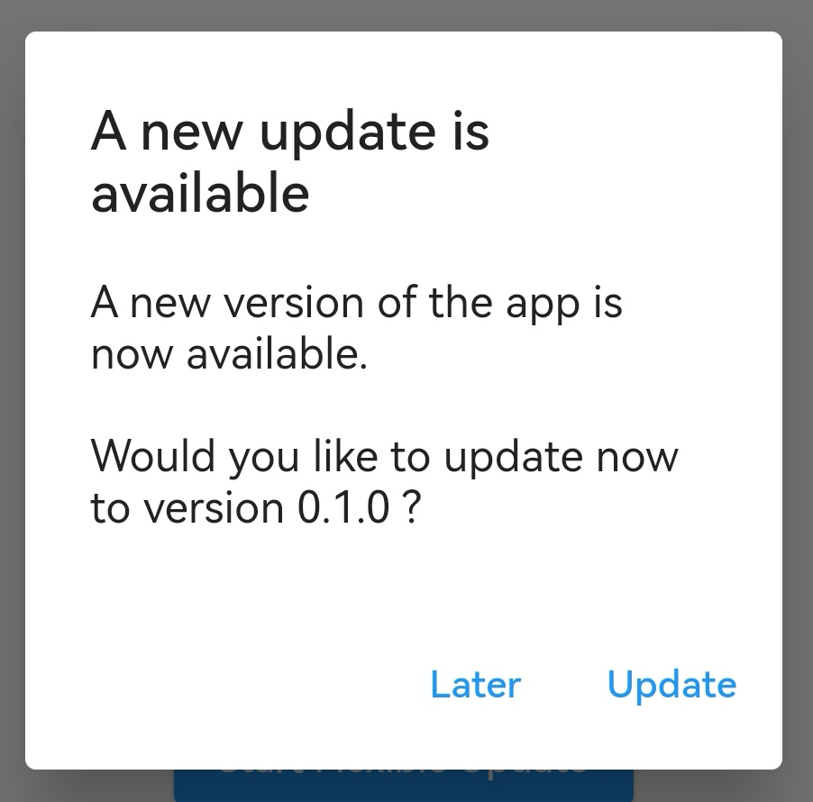
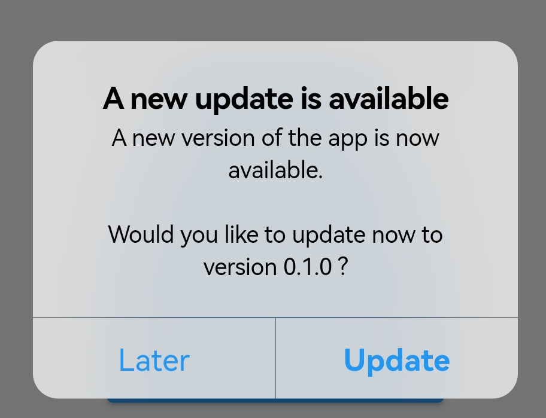
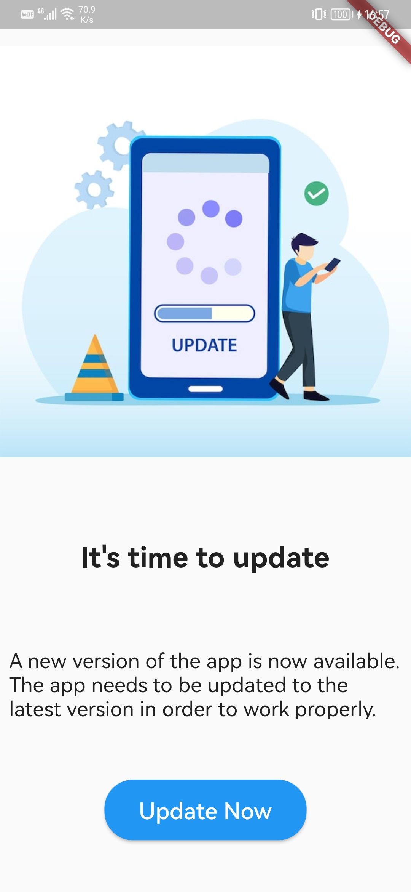

# Playx Version Update

[](https://pub.dev/packages/playx_version_update)
[](https://github.com/playx-flutter/playx_version_update/actions/workflows/ci.yml)
[](https://playx-flutter.github.io/playx_version_update/)
[](LICENSE)

**Keep your Flutter users on the latest version of your app.** Playx Version Update finds new versions,
shows an update dialog or page you can style, and runs **native in-app updates on Android**.

📚 **[Documentation](https://playx-flutter.github.io/playx_version_update/)** ·
🔄 **[Migrating to 2.0](https://playx-flutter.github.io/playx_version_update/docs/migration/migrating-to-2)** ·
🧩 **[API reference](https://playx-flutter.github.io/playx_version_update/api/)**

<p align="center">
  
  
  
</p>

## Features

- 🔎 **Finds new versions** on Google Play, the App Store and the Mac App Store, or from your own backend or
  Firebase Remote Config with pluggable **version sources**.
- 📲 **Native Android in-app updates**: immediate and flexible, with download progress.
- 🎨 **Customizable update UI**: a platform-adaptive dialog and a full-screen page, with your texts, styles and
  release notes.
- 🔒 **Minimum versions**: force an update below a version, per platform.
- ⏰ **"Later" and "Skip this version"** with pluggable storage.
- 📊 **Events** for analytics and **stable error codes** with retry hints.
- 🏪 **Opens the store app** with deep links, with a hook for your own launcher.
- ⚙️ **Network control**: retries, timeouts, headers, your own `Dio`, request logging.

| Platform | Version lookup | Update dialog | In-app update |
| --- | --- | --- | --- |
| Android | Google Play | Material | Google Play |
| iOS | App Store | Cupertino | opens the App Store |
| macOS | Mac App Store | Cupertino | opens the Mac App Store |
| Windows, Linux | custom version source | your own UI | n/a |

## Installation

```yaml
dependencies:
  playx_version_update: ^2.0.0
```

Requires Dart 3.10+ and Flutter 3.38.1+. On sandboxed macOS apps add the
`com.apple.security.network.client` entitlement
([details](https://playx-flutter.github.io/playx_version_update/docs/guides/ios-and-macos)).

## Quick start

Ask users to update with one call:

```dart
await PlayxVersionUpdate.showUpdateDialog(context: context);
```

Customize it, and remember "Later" and "Skip this version":

```dart
await PlayxVersionUpdate.showUpdateDialog(
  context: context,
  uiOptions: PlayxUpdateUIOptions(
    showReleaseNotes: true,
    dismissButtonText: 'Later',
  ),
  reminderOptions: PlayxUpdateReminderOptions(
    snoozeDuration: Duration(days: 3),
    allowSkipVersion: true,
  ),
);
```

Or only check the version and build your own UI:

```dart
final result = await PlayxVersionUpdate.checkVersion();

result.when(
  success: (info) {
    if (info.canUpdate) print('Update to ${info.newVersion}');
  },
  error: (error) => print('${error.errorCode}: ${error.message}'),
);
```

Start a Google Play in-app update on Android (an update dialog on iOS and macOS):

```dart
await PlayxVersionUpdate.showInAppUpdateDialog(
  context: context,
  type: PlayxAppUpdateType.flexible, // or PlayxAppUpdateType.immediate
);
```

Take versions from your own backend or Remote Config instead of the stores:

```dart
PlayxUpdateOptions(
  versionSource: PlayxCallbackVersionSource((request) async {
    return PlayxRemoteVersionInfo(version: await fetchLatestVersion());
  }),
)
```

## Learn more

| | |
| --- | --- |
| [Check for updates](https://playx-flutter.github.io/playx_version_update/docs/guides/check-for-updates) | the result, the options, the errors |
| [Update dialog and page](https://playx-flutter.github.io/playx_version_update/docs/guides/update-dialog-and-page) | showing updates, forced updates |
| [Android in-app updates](https://playx-flutter.github.io/playx_version_update/docs/guides/android-in-app-updates) | immediate, flexible, progress, resume |
| [Version sources](https://playx-flutter.github.io/playx_version_update/docs/guides/version-sources) | Remote Config, your backend, per-platform values |
| [Opening the store](https://playx-flutter.github.io/playx_version_update/docs/guides/opening-the-store) | deep links, your own launcher |
| [Troubleshooting](https://playx-flutter.github.io/playx_version_update/docs/troubleshooting) | common errors and fixes |
| [Testing](https://playx-flutter.github.io/playx_version_update/docs/guides/testing) | test without the stores, in-app update testing |

The [example app](example) shows every feature on Android, iOS and macOS.

## Contributing

Issues and pull requests are welcome at
[github.com/playx-flutter/playx_version_update](https://github.com/playx-flutter/playx_version_update).
Run `flutter analyze` and `flutter test` before opening a pull request. The documentation lives in
[`website/`](website) (Docusaurus): `cd website && npm install && npm start`.

## License

MIT, see [LICENSE](LICENSE).
